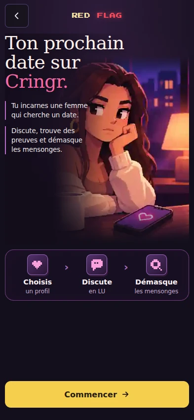
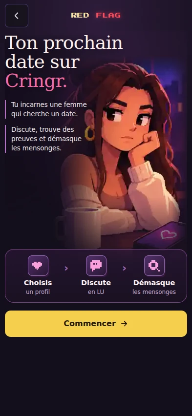
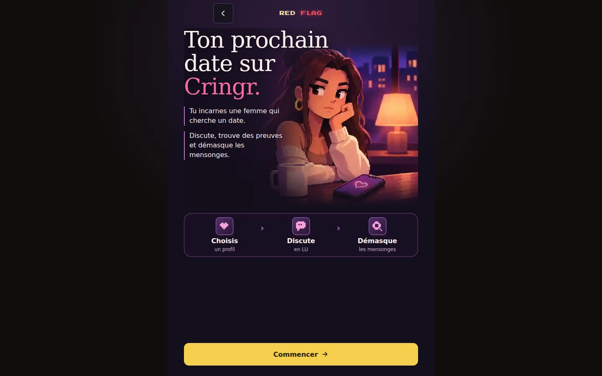
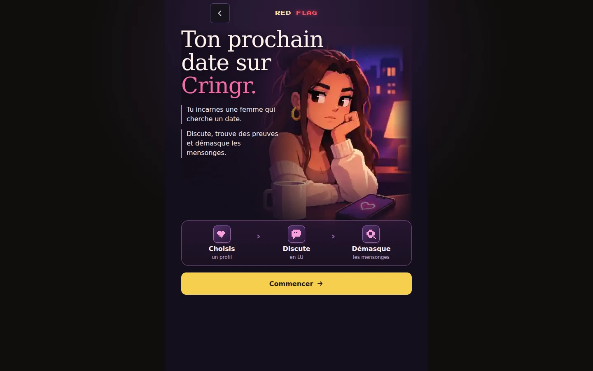

# SPEC 115 V7 — composition verticale et illustration régénérée

Date : 1er novembre 2026 · branche `2.1` · référence mesurée **`6feb2db`**.

## Résultat et périmètre

Le bouton Commencer suit les étapes à **16 px**, sans marge automatique qui l'isole en bas du viewport. Le contenu garde sa hauteur naturelle ; les trois gestes réunissent le héro et l'action. Le halo est porté par la composition entière, le voile de lecture se dissout verticalement, et le visuel descend de 48 px derrière le début du panneau avec un fondu sur les côtés et le bas. Le héro PC passe de 430 à 450 px ; shell 640 px, contenu 560 px.

Titre, deux paragraphes, trois gestes et CTA unique conservés. Aucun badge ajouté. La seule modification JS est le chemin et les dimensions de l'image ; navigation, preuves, score, graines, stockage et audio ne changent pas. CSS/JS chargés en `v=26`.

## Mesures du vrai navigateur

| Viewport | Écart étapes/CTA V6 | V7 | Bas du CTA V7 |
| --- | ---: | ---: | ---: |
| 320×600 | 12 px | 16 px | 597 px |
| 360×740 | 146 px | 16 px | 597 px |
| 393×852 | 164 px | 16 px | 690 px |
| 430×932 | 213 px | 16 px | 720 px |
| 768×1024 | 329 px | 16 px | 715 px |
| 1024×768 | 75 px | 16 px | 715 px |
| 1440×900 | 206 px | 16 px | 715 px |
| 1920×1080 | 385 px | 16 px | 715 px |

Aucun débordement horizontal dans ces huit configurations. Le CTA mesure au moins 54 px. L'espace disponible sous le groupe reste libre sur une grande fenêtre ; il ne sépare plus les étapes du bouton. À 320×600, le bas de page conserve son défilement naturel pour les safe areas.

### Comparatifs permanents

Captures réelles de la même entrée depuis Jeux ; conversion WebP pour la documentation. Les PNG complets et les mesures JSON sont produits par `tests/test_lux_demasque_accueil_v7.py` et archivés par la CI dédiée.

| | V6 — référence | V7 |
| --- | --- | --- |
| Mobile 393×852 |  |  |
| PC 1440×900 |  |  |

## Tests exécutés et limites

- `tools/test-lux-demasque.sh rapide` : **3/3 blocs PASS** (syntaxe JS/Python, moteur, générateur, sélection). Le test V5 attendait encore un breakpoint 350 px lié aux capsules retirées en V6 : il attend désormais le breakpoint mobile effectif 360 px. Aucun moteur corrigé pour satisfaire ce test.
- `tools/test-lux-demasque.sh complet` : **12/13 blocs PASS**. Seul `test_lux_demasque_audio.py` échoue en attendant `#ld-verdict` après l'objection `PIX_KYOTO` ; **même échec reproduit sur `6feb2db`**. La suite complète n'est donc pas déclarée verte.
- `tests/test_lux_demasque_accueil.py` : **FIX-01 à FIX-10 PASS**, y compris première entrée et réouvertures, double appui, Retour, erreurs API, image 404, stockage refusé, sauvegardes, focus/Entrée, mouvement réduit, zoom 130/200 %, Lux Match puis Cringr. L'attente de titre du test sans image a été normalisée pour les retours à la ligne HTML déjà introduits en V5.
- `tests/test_lux_demasque_accueil_v7.py` : **8/8 PASS**, avec capture, mesure réelle, écart borné 12–24 px, largeur centrée et CTA accessible.
- `tools/critique.sh rapide` exécuté : rouge sur l'entrée LOD **Awar!**, échec déjà documenté avant cette passe ; les tests Node de RED FLAG passent. La suite critique complète transversale n'est pas rejouée pour ce changement CSS isolé, conformément à l'exception du PLAYBOOK ; la suite navigateur dédiée complète l'est.

Samsung réel, lecteur d'écran réel et réglages de police système **non testés**. LD-049 reste ouverte pour approbation Produit ; LD-002.01 reste la prochaine action. Le correctif d'introduction n'est pas une clôture des autres écrans.

## Vérification GitHub Actions après push

Sur le code [`f1bea1c`](https://github.com/aym2020/LuxApp/commit/f1bea1c74e38c8f2d86ccda8ffa6b841e5716e72), les CI **Interface**, **Gabarits SPEC 114**, Boutons révision, Mot caché, Défis et Recettes P0-01 sont vertes. [Gabarits et captures avant/après](https://github.com/aym2020/LuxApp/actions/runs/41306141873).

La CI RED FLAG confirme **12/13 blocs**, avec `test_lux_demasque_accueil` et `test_lux_demasque_accueil_v7` verts ; seul l'audio mentionné ci-dessus échoue. Les [captures V7 sont archivées](https://github.com/aym2020/LuxApp/actions/runs/41306141947/artifacts/13083715489).

Le contrôle CI **Œil du mot de passe** échoue aussi (bascule au clavier, `test_portail_mdp_mobile.py:64`), y compris après une relance. Sa fixture charge uniquement `design-tokens.css`, `components.css`, `style.css` et `portail.js` : **aucun de ces fichiers ni le test n'a changé dans ce diff**. Relecture locale sur la référence `6feb2db` et la V7 : **les cinq tailles passent dans les deux versions**. Cette divergence CI reste ouverte ; aucune correction du portail n'est glissée dans la retouche RED FLAG. La CI globale n'est pas présentée comme entièrement verte.

## Illustration et provenance

Asset intégré : [redflag-hero-v7.webp](../../public/art/redflag-hero-v7.webp), **1254×1254 px, 73 890 octets**. Générateur d'images intégré (skill `imagegen`), édition depuis l'asset V4 ; conversion WebP qualité 88, méthode 6. La tasse est régénérée avec une céramique unie, sans cache SVG ; le cœur rose du téléphone est conservé. L'image n'embarque aucun texte d'interface.

Prompt utilisé :

```text
Use case: precise-object-edit. Edit target: the supplied RED FLAG game illustration. Regenerate this same square illustration with ONE localized change: remove the red/pink heart printed on the ceramic coffee mug in the lower-left foreground. The mug must be plain light cream/lavender ceramic, naturally shaded and with consistent pixel texture, with no emblem, logo, sticker or heart. Preserve EVERYTHING ELSE: same adult brunette woman, exact face identity, skeptical expression, pupils, hair bun, gold earring, head supported by hand, cream sweater, pose, proportions; same purple night window/city, warm orange lamp, wood table, coffee. Crucially KEEP the bright pink heart visible on the smartphone at the lower right. Keep the original composition, camera, colors, lighting, painterly pixel-art game style and square framing. No typography, no added UI, no extra objects, no redesign. Render clean edges at the original image proportions for production use.
```
